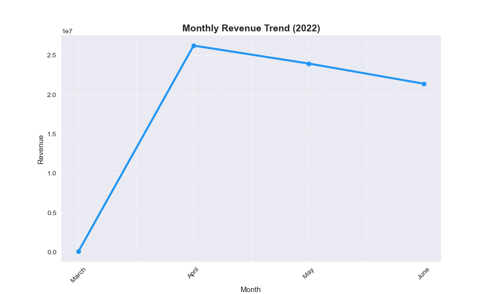
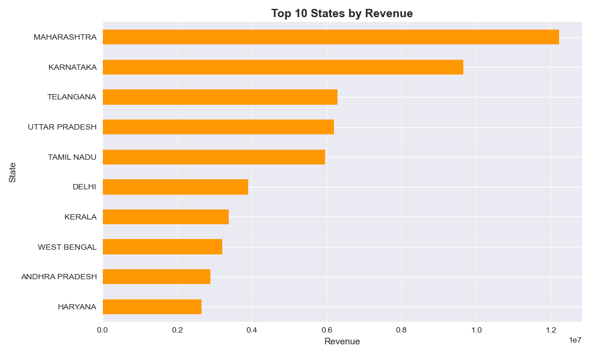

# 📊 Customer & Sales Analysis

## 📌 Overview
This project analyzes customer behavior and sales data to extract meaningful business insights.

The goal is to understand:
- Sales performance over time
- Top-performing product categories
- Revenue distribution across different states

This project simulates a real Data Analysis & Data Engineering workflow using Python and MySQL.

---

## 📊 Dataset
The dataset contains transactional sales data including:
- Order ID
- Order Date
- Customer ID
- Product Name & Category
- Quantity & Price
- Total Amount
- State & Country
- Payment Method
- Order Status

---

## ⚙️ Tools & Technologies
- Python
- Pandas
- Matplotlib
- MySQL
- SQL

---

## 🧹 Data Cleaning
- Converted OrderDate to datetime format
- Handled missing values
- Structured data for database insertion
- Loaded data into MySQL database

---

## 📈 Key Analysis

### 1. Total Revenue
- Calculated total sales from all transactions

### 2. Top Categories by Revenue
- Identified highest revenue-generating categories

### 3. Monthly Revenue Trend
- Analyzed revenue changes over time

### 4. Top States by Revenue
- Found top-performing regions

---

## 📊 Visualizations

### 🔹 Top Categories
- Horizontal bar chart showing revenue by category

### 🔹 Monthly Revenue Trend
- Line chart showing revenue growth over time

### 🔹 Top States
- Horizontal bar chart for better comparison

---

## 📊 Sample Visualizations

### Top Categories

### Monthly Sales Trend

### Top States

---

## 📌 Key Insights
- Revenue is distributed across multiple categories
- Monthly sales trend shows stable performance with slight fluctuations
- Certain states dominate overall revenue contribution

---

## 🚀 How to Run the Project

1. Clone the repository:
`bash
git clone https://github.com/Hassan3443/customer-sales-analysis.git
2. Install dependencies:
pip install pandas matplotlib mysql-connector-python
3. Run the script:
python analysis.py
