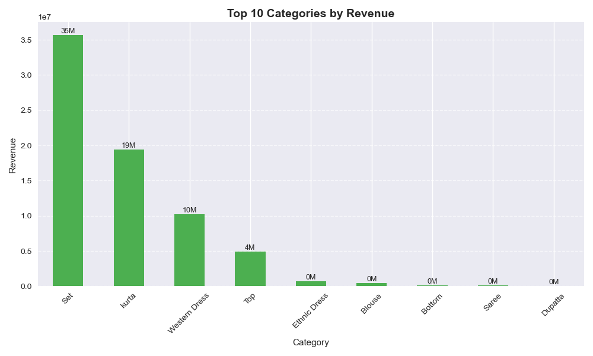

# 🛒 E-commerce Sales Data Analysis

## 📌 Overview
This project analyzes an E-commerce sales dataset to extract meaningful business insights.

The goal is to understand:
- Sales performance over time
- Top-performing product categories
- Revenue distribution across states

This project is part of my journey in Data Analysis and Data Engineering through the DEPI program.

---

## 📊 Dataset
The dataset contains transactional sales data including:

- Order ID
- Date
- Product Category
- Sales Amount
- State (Location)
- Order Status

---

## ⚙️ Tools & Technologies
- Python
- Pandas
- Matplotlib

---

## 🧹 Data Cleaning
- Converted `Date` column to datetime format
- Removed cancelled orders
- Handled missing values in key columns (Amount, Category, State)

---

## 📈 Key Analysis

### 1. Total Revenue
- Calculated total sales across all transactions

### 2. Top Categories by Revenue
- Identified the highest revenue-generating product categories

### 3. Monthly Sales Trend
- Analyzed how revenue changes over months

### 4. Top States by Revenue
- Found which states generate the highest sales

---

## 📊 Visualizations

### 🔹 Top Categories
- Bar chart showing highest revenue categories

### 🔹 Monthly Sales Trend
- Line chart showing revenue growth over time

### 🔹 Top States
- Horizontal bar chart for better readability

---
## 📊 Sample Visualizations

### Top Categories


### Monthly Sales Trend


### Top States


## 📌 Key Insights
- A small number of categories generate the majority of revenue
- Sales peaked significantly in April
- Maharashtra and Karnataka are the top revenue-generating states

---

## 🚀 How to Run the Project

1. Clone the repository:
```bash
git clone https://github.com/Hassan3443/ecommerce-sales-analysis.git
